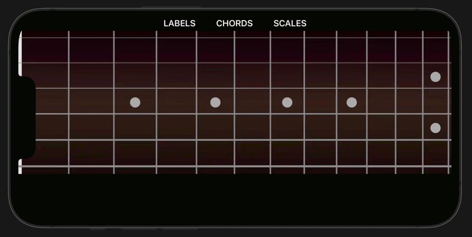

# FretboardHeatmap 
A mobile app to help guitarists visualize notes on a fretboard. Contains source code the for React Native, iOS and Android versions. 



# Structure
```bash
fretboard-heatmap-monorepo/
├── android-native/
│   └── FretboardHeatmap/ 
└── ios-native/
└── react-native/             
   ```

# Repositories 
* [React Native](./react-native/README.md)
* [iOS](./ios-native/README.md)
* [Android](./android-native/FretboardHeatmap/README.md)